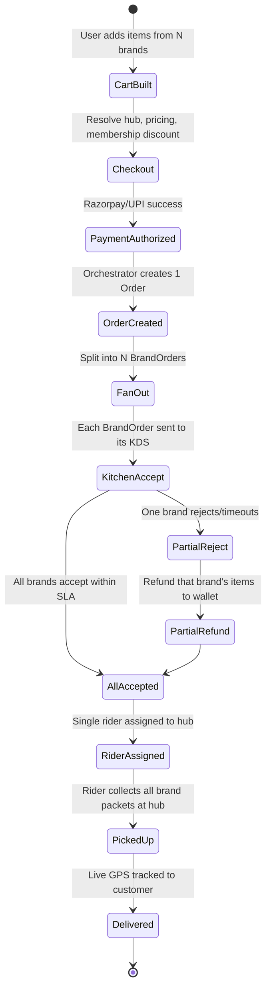
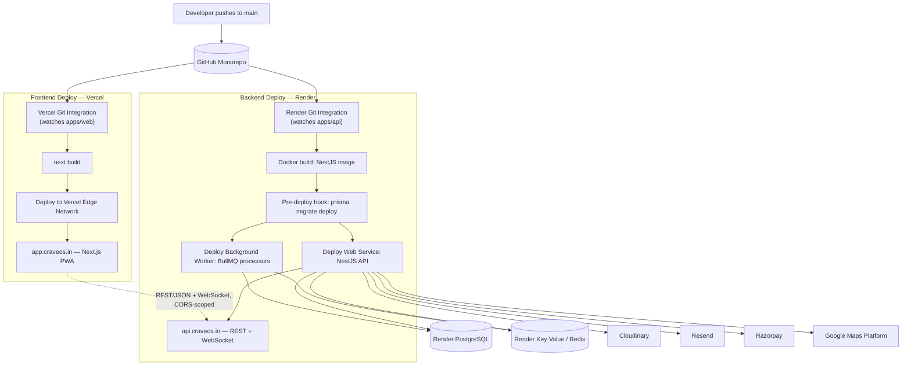

# 🍽️ CraveOS — Multi-Brand Cloud-Kitchen Food Delivery Platform: Software Development Documentation Package

*(Reference blueprint reverse-engineered from the observable product, business model, and public technical footprint of eatclub.in — India's multi-brand cloud-kitchen food delivery platform, operator of BOX8, MOJO Pizza, LeanCrust, Itminaan Matka Biryani, ZAZA Mughal Biryani, Mealful Rolls, NH1 Bowls, WeFit Bowls and other in-house brands.)*

---

## 1. Executive Summary

### 1.1 Product Overview
**CraveOS** is a multi-brand cloud-kitchen commerce platform that lets a single customer order from *several in-house food brands in one cart, one payment, and one delivery trip*. Unlike a classic marketplace (Zomato/Swiggy-style) that aggregates thousands of independent, third-party restaurants, CraveOS is built around a much tighter model: a portfolio of company-owned virtual restaurant brands (pizza, biryani, desi meals, rolls, high-protein bowls, etc.) that are physically co-located inside shared "Cloud-Kitchen Hubs." Because every brand a customer can order from typically ships out of the same physical kitchen, CraveOS can guarantee a single pickup, a single delivery fee (₹0), and a single ETA — even when the cart contains a pizza from one brand and a biryani from another.

### 1.2 Purpose
This document specifies the technical design, product requirements, and execution plan required to build a system functionally equivalent to eatclub.in. It is written for engineers, product designers, and QA to use as the architectural blueprint for construction, covering the storefront, the multi-brand ordering engine, the membership/discount system, logistics dispatch, and the operational back office.

### 1.3 Business Goals & Core Value Proposition
* **Own the Margin:** Route 100% of demand through owned/first-party channels instead of third-party marketplaces, avoiding the 20–30% commission leakage of aggregator platforms and capturing full retail margin on every order.
* **One Cart, Many Brands:** Increase Average Order Value by letting customers mix items from multiple in-house brands into a single checkout ("brand-in-brand" bundling), fulfilled from a single kitchen hub.
* **Flat, No-Asterisk Savings:** Replace confusing surge pricing and coupon hunting with a single, always-on value proposition — a flat percentage off every order for members, plus zero delivery/packaging/platform fees — to drive trust and repeat frequency.
* **Speed as a Feature:** Guarantee sub-25-minute delivery by pre-positioning inventory and staff at dense, hyperlocal cloud-kitchen hubs rather than relying on scattered independent restaurants of variable prep speed.
* **Recurring Revenue via Membership:** Convert one-time buyers into subscribing members (free trial → paid tiers) to lock in frequency, predictable cash flow, and higher lifetime value.

### 1.4 Intended Users
* **Guest/Anonymous Browsers:** People discovering brands, menus, and offers before creating an account.
* **Registered Customers:** Authenticated users who order, hold a wallet balance, refer friends, and subscribe to membership.
* **Delivery Partners (Riders):** Gig-economy fleet members who accept, pick up, and complete delivery trips, tracked live on the map.
* **Kitchen/Hub Staff:** On-ground staff at a Cloud-Kitchen Hub who accept orders on a Kitchen Display System (KDS), mark items ready, and hand off to riders.
* **Brand Operations Managers:** Category-level staff (e.g. "BOX8 Ops") who manage menu, pricing, and item availability for one brand across all hubs.
* **Hub Managers:** Staff responsible for one physical location — staffing, stock, multi-brand throughput, and rider handoff at that address.
* **Customer Support Agents:** Staff handling live-order escalations, refunds, and chat/call support.
* **Platform (Super) Admins:** HQ staff who configure cities, hubs, membership pricing, platform-wide offers (Happy Hours, Meal of the Day), and view company-wide analytics.

---

## 2. Product Requirements Document (PRD)

### 2.1 Core Features List

#### Discovery & Storefront
1. **Brand Storefront Grid:** Home feed showing all serviceable in-house brands (BOX8, MOJO Pizza, LeanCrust, etc.) as tappable tiles, each opening into a dedicated brand menu.
2. **Unified Search:** Cross-brand search by dish, cuisine, or brand name, ranked by relevance and serviceability.
3. **Time-Bound Deal Rails:** Home-page carousels for **Meal of the Day** (starts @₹99), **Happy Hours** (daily 4–6 PM, @₹99), and rotating **BOGO** offers, computed server-side per time window.

#### Multi-Brand Ordering Engine
4. **Single Multi-Brand Cart:** Add items from any number of serviceable brands into one cart, grouped visually by brand, with one combined bill.
5. **Cart-Level Pricing Transparency:** Line-by-line breakdown of MRP, membership discount, item-level offers, delivery fee (₹0), packaging fee (₹0), platform fee (₹0), and taxes.
6. **Order Fan-Out:** On payment success, the single order is split server-side into per-brand "Brand Orders" routed to each brand's Kitchen Display System within the fulfilling hub, while the customer sees one order.

#### Membership & Growth Loops
7. **EatClub-style Membership:** Free ₹0 trial converting to a paid quarterly/annual plan; members get a flat % off every order plus zero delivery/packaging/platform fees, applied automatically at checkout.
8. **Wallet & Referral Program:** In-app wallet credited via referral bonuses (new user + referrer), cashback-style "Dining/Order Credit," and promotional grants; wallet balance is auto-applied at checkout.
9. **Coupon Engine:** Stackable/non-stackable promo codes with min-order-value, brand-scoping, first-order-only, and usage-limit rules.

#### Fulfillment & Live Ops
10. **Live Order Tracking:** Real-time order-state timeline (Placed → Accepted → Preparing → Rider Assigned → Picked Up → Arriving → Delivered) with a live rider map.
11. **Serviceability Engine:** Determines, from the delivery address, which Cloud-Kitchen Hub(s) — and therefore which brand menus — are deliverable to that address, with delivery-time estimates.
12. **In-App Support & Refunds:** Chat-first support widget scoped to the active/most-recent order, with agent handoff and an automated refund-to-wallet flow for failed/cancelled/incorrect orders.

#### Back Office / Admin
13. **Hub & Menu Console:** Ops dashboard to manage hubs, brand-hub mappings, menu items, stock/86'd items, and pricing per city.
14. **Delivery Dispatch Console:** Live map of riders, order queue, and manual reassignment tools for support/ops.
15. **Analytics & Reporting:** Order volume, AOV, brand mix, membership conversion, and hub-level throughput dashboards.

---

### 2.2 Functional Requirements

#### Discovery
* Anonymous users must be able to browse full menus and add items to a cart without creating an account; login is only required at the payment step.
* Item and brand availability must reflect real-time stock and kitchen load (an item can be temporarily marked unavailable, or "86'd," by hub staff without a deploy).

#### Multi-Brand Cart & Checkout
* A cart may contain items from multiple brands, but only from brands that are servable from the **same** resolved Cloud-Kitchen Hub for the user's delivery address; adding an item from a brand fulfilled by a different hub must either (a) be blocked with a clear message, or (b) prompt the user to start a new cart.
* The system must compute, at checkout time, one consolidated `Order` and N `BrandOrder` records (one per distinct brand in the cart), all sharing a single `Payment` and a single `DeliveryTrip`.
* Membership discount, wallet credit, and coupon codes must be evaluated in a fixed, deterministic priority order and reflected identically in the cart preview and the final invoice.

#### Membership
* New users are automatically eligible for a time-boxed free trial membership; the system must auto-expire the trial and prompt renewal/upgrade without disrupting an order in progress.
* Membership benefits (flat % off, zero delivery/packaging/platform fee) must apply automatically at checkout with no coupon code required, and must be visibly distinguished from one-off promo discounts.

#### Fulfillment
* A rider must be assigned only after all `BrandOrder`s in a given `Order` have been accepted by their respective kitchens.
* If any single `BrandOrder` is rejected or exceeds its SLA (e.g., "kitchen too busy"), the system must offer the customer an automatic partial cancellation-and-refund for just that brand's line items, or a full-order cancellation, without penalizing the successfully accepted brand orders.
* Order status transitions must be pushed to the client in real time (sub-5-second latency) via a persistent WebSocket connection, with an HTML transactional email (Resend) fallback for major status changes if the browser tab is backgrounded or closed.

#### Support & Refunds
* Refunds must default to wallet credit (instant) with an option for the customer to request original-payment-method refund (T+5–7 days), consistent with the payment gateway's refund window.

---

### 2.3 Non-Functional Requirements
* **Peak Throughput:** The order-placement path must sustain lunch/dinner peak load (11:30 AM–2 PM, 7–11 PM, and the 4–6 PM Happy Hour spike) without checkout latency exceeding 2 seconds at p95.
* **Availability:** Core ordering path (browse → cart → pay) must maintain ≥99.9% uptime; a single hub or brand outage must degrade gracefully (that brand/hub hidden) rather than taking down the app.
* **Payment Reliability:** Payment capture and order confirmation must be idempotent and reconciled via webhook, so a flaky network on the customer's device never produces a charged-but-unconfirmed order.
* **Data Protection:** Personal data (name, phone, address, payment tokens) must be encrypted in transit (TLS 1.3) and at rest, in line with India's DPDP Act obligations, with a user-triggered data-deletion flow.
* **Performance Budget:** The public storefront (PWA) must achieve a Google Mobile PageSpeed score ≥ 90, with the brand-menu page interactive in under 2.5 seconds on a mid-range Android device over 4G.
* **Accessibility:** Ordering flows must be operable via screen reader and keyboard, meeting WCAG 2.1 AA.
* **Geographic Scale:** The serviceability engine must support 7+ metro cities and hundreds of hubs, with sub-200ms geofence resolution for "which hub serves this address."

---

### 2.4 User Roles & Permissions Matrix

| Module / Feature | Guest | Customer | Delivery Partner | Kitchen/Hub Staff | Brand Ops Manager | Support Agent | Platform Admin |
| :--- | :---: | :---: | :---: | :---: | :---: | :---: | :---: |
| **Browse brands & menus** | ✅ | ✅ | ❌ | ✅ (own hub) | ✅ | ✅ | ✅ |
| **Add to multi-brand cart / checkout** | ✅ | ✅ | ❌ | ❌ | ❌ | ❌ | ✅ (test mode) |
| **View own order history** | ❌ | ✅ | ✅ (assigned trips) | ❌ | ❌ | ✅ (any, for support) | ✅ |
| **Accept/reject Brand Orders on KDS** | ❌ | ❌ | ❌ | ✅ | ❌ | ❌ | ✅ |
| **Mark item out-of-stock ("86")** | ❌ | ❌ | ❌ | ✅ | ✅ | ❌ | ✅ |
| **Edit brand-wide menu/pricing** | ❌ | ❌ | ❌ | ❌ | ✅ | ❌ | ✅ |
| **Accept delivery trip / update GPS** | ❌ | ❌ | ✅ | ❌ | ❌ | ❌ | ❌ |
| **Manually reassign a stuck rider** | ❌ | ❌ | ❌ | ❌ | ❌ | ✅ | ✅ |
| **Issue refund / wallet credit** | ❌ | ❌ | ❌ | ❌ | ❌ | ✅ (bounded) | ✅ |
| **Configure Happy Hour / Meal-of-Day rules** | ❌ | ❌ | ❌ | ❌ | ✅ (own brand) | ❌ | ✅ |
| **View hub-level financial reports** | ❌ | ❌ | ❌ | ✅ (own hub) | ✅ (own brand) | ❌ | ✅ |
| **View platform-wide analytics** | ❌ | ❌ | ❌ | ❌ | ❌ | ❌ | ✅ |
| **Manage cities / open new hubs** | ❌ | ❌ | ❌ | ❌ | ❌ | ❌ | ✅ |

---

### 2.5 Edge Cases & Constraints

#### Partial Brand-Order Rejection
If one brand's kitchen (e.g., MOJO Pizza) is overloaded and rejects its `BrandOrder` while a `BOX8` `BrandOrder` in the same parent `Order` has already been accepted, the system must not cancel the whole order. It automatically refunds the rejected brand's line items to the customer's wallet, updates the invoice total, and continues fulfillment for the accepted brand(s), notifying the customer of the partial change before dispatch.

#### Membership Expiry Mid-Cart
If a user's paid membership expires while items sit in an open cart, prices shown in the cart must be **recomputed at checkout time**, not frozen at add-to-cart time — the checkout screen must clearly surface the price change ("Your membership expired — savings removed") rather than silently charging a higher amount.

#### Cross-Hub Cart Conflict
If a user's saved delivery address changes such that the currently resolved hub can no longer serve one or more brands already in the cart, those items are flagged and the user is prompted to remove them or switch address before proceeding — the cart is never silently auto-emptied.

#### Payment Success, Order Confirmation Delay
If Razorpay/UPI confirms payment but the app loses connectivity before receiving the order-confirmation response, the order is created server-side in `PENDING_CONFIRMATION` status; a webhook listener reconciles it to `CONFIRMED` within seconds and the order appears in the user's order history on next app open — the user is never charged twice for a retried payment (idempotency key = cart checksum + user + timestamp window).

---

## 3. Technical Architecture

### 3.1 High-Level System Architecture
CraveOS ships as **two independently deployed applications** — a Next.js frontend+Tailwind CSS and a NestJS backend — that communicate exclusively over a versioned REST/JSON API. This is a deliberate, explicit split (not a single full-stack Next.js app with API routes) because it lets each half run on the hosting platform it's actually good at: Vercel's global edge network for the frontend's static/ISR/SSR delivery, and Render's persistent, always-on compute for the backend's stateful API, WebSocket connections, and scheduled/background jobs.

Within the backend, CraveOS is built as a **modular monolith**: one NestJS application composed of independently-testable feature modules (Catalog, Cart & Order Orchestrator, Payment & Wallet, Membership & Pricing, Logistics & Dispatch, Notification, Identity & Auth), all sharing a single PostgreSQL database with logical separation through different PostgreSQL schemas. This is a deliberate simplification versus a Kafka-driven microservices-on-Kubernetes topology: at CraveOS's target scale, a modular monolith is faster to ship and far simpler to operate on a PaaS like Render — no service mesh, no per-service database, no Kafka cluster to run and monitor. Module boundaries are still kept clean (each module owns its own Prisma models, service class, and controller) so that any single module — Logistics & Dispatch being the most likely candidate — can be extracted into its own Render service later without a rewrite, if and when real traffic demands it.

```
                         ┌────────────────────────────────┐
                         │           FRONTEND               │
                         │     Next.js App (Vercel)          │
                         │  Web PWA — SSR + ISR + Edge Cache  │
                         └───────────────┬───────────────────┘
                                         │  REST/JSON over HTTPS
                                         │  (CORS-scoped, /api/v1, JWT auth)
                                         │  + WebSocket (order tracking)
                         ┌───────────────▼───────────────────┐
                         │            BACKEND                 │
                         │     NestJS API (Render Web Service)  │
                         │ ┌───────────┐ ┌────────────────────┐ │
                         │ │ Catalog & │ │  Cart & Order       │ │
                         │ │ Service-  │ │  Orchestrator       │ │
                         │ │ ability   │ │  (fan-out)          │ │
                         │ └───────────┘ └────────────────────┘ │
                         │ ┌───────────┐ ┌────────────────────┐ │
                         │ │ Payment & │ │  Membership &       │ │
                         │ │ Wallet    │ │  Pricing (offers)   │ │
                         │ └───────────┘ └────────────────────┘ │
                         │ ┌───────────┐ ┌────────────────────┐ │
                         │ │ Logistics │ │  Notification        │ │
                         │ │ & Dispatch│ │  (Resend HTML email) │ │
                         │ └───────────┘ └────────────────────┘ │
                         │ ┌────────────────────────────────┐   │
                         │ │      Identity & Auth Module      │   │
                         │ └────────────────────────────────┘   │
                         └────────┬──────────────────┬───────────┘
                                  │                  │
                    ┌─────────────┘                  └──────────────┐
                    ▼                                                ▼
        ┌─────────────────────────┐                    ┌──────────────────────────┐
        │  PostgreSQL (Render)      │                    │  Redis (Render Key Value)  │
        │  single DB, via Prisma ORM │                    │  cache + BullMQ job queues │
        └─────────────────────────┘                    └────────────┬─────────────┘
                                                                       │
                                                                       ▼
                                                          ┌──────────────────────────┐
                                                          │  Background Worker         │
                                                          │  (Render Worker service)    │
                                                          │  BullMQ processors: order-   │
                                                          │  fan-out side effects,       │
                                                          │  email sends, reconciliation │
                                                          └──────────────────────────┘

  External services called directly by the NestJS backend (no self-hosted infra):
  ┌────────────────┐ ┌───────────────────┐ ┌────────────────┐ ┌─────────────────────────┐
  │   Cloudinary     │ │      Resend         │ │   Razorpay      │ │   Google Maps Platform    │
  │ (menu photography,│ │ (HTML transactional │ │ (payments +     │ │ (Geocoding, Places        │
  │  brand logos,     │ │  email: confirma-   │ │  webhooks)      │ │  Autocomplete, Routes API  │
  │  optimized delivery)│ │  tions, refunds,    │ │                 │ │  for drive-time ETA)       │
  │                    │ │  membership renewals)│ │                 │ │                            │
  └────────────────┘ └───────────────────┘ └────────────────┘ └─────────────────────────┘
```

Inside the NestJS app, modules call each other's services directly via dependency injection for synchronous request/response needs (e.g., "is this address serviceable?"), and push jobs onto **BullMQ queues** (backed by the same Redis instance) for anything that should happen asynchronously without blocking the request — order placed → notify kitchens' KDS, send confirmation email, update analytics counters. A dedicated Render **Background Worker** service runs the BullMQ processors so that a slow email send or a retrying webhook job never competes with the API's request-handling capacity.

### 3.2 Frontend Application Structure
The public web app is a Next.js **Progressive Web App**, deployed on **Vercel**, so the "Add to Home Screen" experience gives mobile users an app-like feel without shipping a native binary (native mobile apps are deliberately out of scope for V1 — see §13, Future Enhancements).

```
src/
├── app/
│   ├── (storefront)/            # Public browsing — ISR + Vercel edge cache
│   │   ├── page.tsx             # Home: brand grid, deal rails
│   │   ├── brand/[slug]/        # Brand menu page
│   │   └── search/
│   ├── cart/                    # Multi-brand cart (client-heavy)
│   ├── checkout/                # Address, payment, membership upsell
│   ├── orders/[id]/track/       # Live order tracking (WebSocket to Render API)
│   ├── membership/               # Membership plans & upgrade
│   ├── account/                 # Profile, wallet, referrals, addresses
│   └── admin/                   # Hub/menu console (internal)
│       ├── kds/                 # Kitchen Display System
│       └── dispatch/            # Rider dispatch console
├── components/                  # Shared UI (design system)
├── hooks/                       # useCart, useServiceability, useLiveOrder
├── lib/                         # api-client.ts (typed fetch wrapper around the
│                                 # NestJS API), google-maps.ts, pricing-display.ts
└── services/                    # Client-side orchestration helpers
```

This app has **no `app/api/` route handlers of its own** — unlike a typical single-deploy Next.js app, CraveOS's Next.js project is a pure client of the NestJS backend. The one exception is the Razorpay Checkout SDK, which is loaded client-side and posts payment confirmation straight to the NestJS `/webhooks/razorpay` endpoint on Render, never through Next.js. This keeps the frontend fully static/edge-renderable and free of server secrets (API keys for Cloudinary, Resend, Razorpay, and Google Maps' server-side APIs live only in Render's environment, never in the Vercel-deployed bundle; the Next.js app holds only the browser-restricted Google Maps JavaScript API key for the address-autocomplete widget).

### 3.3 Backend Module Breakdown (NestJS Modular Monolith)
All modules below live inside the single NestJS application deployed to Render and share the one Render PostgreSQL database via Prisma. "Dependencies" lists what each module additionally reaches for.

| Module | Responsibility | Dependencies |
| :--- | :--- | :--- |
| **Catalog & Serviceability** | Brands, hubs, menu items, stock flags, geofence resolution | PostgreSQL + Redis (geo cache) + Google Maps Geocoding/Places APIs |
| **Cart & Order Orchestrator** | Multi-brand cart state, checkout pricing snapshot, order fan-out | PostgreSQL (Prisma `$transaction`) |
| **Payment & Wallet** | Razorpay integration, wallet ledger, refunds | PostgreSQL (ledger-style, append-only) + Razorpay SDK/webhooks |
| **Membership & Pricing** | Membership plans, trial lifecycle, Happy Hour/Meal-of-Day rule engine, coupons | PostgreSQL + Redis (hot pricing-rule cache) |
| **Logistics & Dispatch** | Rider pool, trip assignment, live GPS, KDS order queue | PostgreSQL + Redis (geospatial `GEOSEARCH`) + Google Maps Routes API (ETA) |
| **Notification** | HTML transactional email — order confirmation, partial-refund notice, membership renewal reminder | Resend (HTML templates), queued via BullMQ and sent by the Background Worker |
| **Search & Discovery** | Cross-brand item/brand search and ranking | PostgreSQL full-text search (`tsvector` + `pg_trgm`) — see §13 for a dedicated search-engine upgrade path |
| **Identity & Auth** | Email OTP login, sessions, RBAC for staff roles | PostgreSQL + Redis (session store) |

Because every module reads/writes the same database, cross-module reads that used to require a network hop in the microservices design (e.g., Cart & Order Orchestrator checking Catalog for `MenuItem.isAvailable`) are now in-process Prisma calls — lower latency and no partial-failure handling needed for what is fundamentally a single-transaction concern.

### 3.4 State Management & Data Fetching
* Global cart and serviceability state is held in a lightweight client store (Zustand/Redux Toolkit) synced to the server on every mutation — the server is always the pricing source of truth; the client never computes discounts itself.
* Storefront/menu reads use Next.js ISR (revalidate every 60–300s) served from Vercel's edge network, layered on top of a Redis-backed response cache inside the NestJS API (Render Key Value) for hot brands/cities, so a cache miss on the edge still hits a warm cache rather than PostgreSQL directly.
* Cart, checkout, and order-tracking reads are always `no-store`/live — pricing and stock can change second to second.
* Forms (address, checkout) use React Hook Form + Zod; mutations go through typed API-client calls, never ad-hoc `fetch`.

### 3.5 Multi-Brand Order Fan-Out (Event Flow)



### 3.6 Serviceability & Geofencing Engine
* Every **Cloud-Kitchen Hub** has a lat/long and a serviceable-radius polygon (drawn, not just a circle, to exclude e.g. a river or highway divide), stored as a GeoJSON `Json` field on `Hub` in Postgres and mirrored into Redis as a geo-set for fast lookups.
* On address entry, the Next.js client uses the **Google Maps Places Autocomplete** widget (browser-key, billed to the frontend) so the user never free-types an unstructured address; on selection, the client sends the resolved `place_id` and lat/lng to the NestJS API. If only a raw address string is available (e.g., a saved address typed before this flow existed), the backend resolves it server-side via the **Google Maps Geocoding API**.
* The Catalog & Serviceability module performs a point-in-polygon lookup against the Redis geo-set (`GEOSEARCH`) to return the ranked list of hubs that cover the point, and therefore which brands/menus are orderable.
* If two hubs both cover the address, the nearer hub is selected by real drive-time ETA — computed via the **Google Maps Routes API** (the current, actively-maintained replacement for the older Distance Matrix API, which Google has placed in Legacy status) — rather than straight-line distance, with a manual "switch hub" affordance if the customer wants a brand only available at the farther hub (accepting a longer ETA).

### 3.7 Frontend–Backend Separation & Deployment Flow
CraveOS is a **monorepo with two independently deployable apps**, not a single deploy target:

```
craveos/
├── apps/
│   ├── web/         # Next.js frontend — deployed to Vercel
│   └── api/          # NestJS backend — deployed to Render (Web Service + Worker)
├── packages/
│   └── shared-types/ # Generated Prisma types + DTO/zod schemas shared by both apps
├── docker-compose.yml # Local dev only — see below
└── prisma/            # Single schema, lives inside apps/api
```

The two apps have **separate CI/CD pipelines, separate environment variables, and separate scaling knobs** — a frontend content update never triggers a backend redeploy, and a backend hotfix (e.g., a Logistics & Dispatch bug) never triggers a Vercel rebuild.



**Local development parity.** A root-level `docker-compose.yml` spins up the NestJS API, PostgreSQL, and Redis as containers on every engineer's machine, so local behavior matches the Render topology (same Postgres major version, same Redis, same `prisma migrate dev` flow) instead of drifting toward SQLite or in-memory stand-ins:

```yaml
# docker-compose.yml (abridged)
services:
  api:
    build: ./apps/api
    ports: ["3001:3001"]
    env_file: ./apps/api/.env.local
    depends_on: [postgres, redis]
  postgres:
    image: postgres:16
    environment:
      POSTGRES_DB: craveos
      POSTGRES_PASSWORD: localdev
    ports: ["5432:5432"]
    volumes: ["pgdata:/var/lib/postgresql/data"]
  redis:
    image: redis:7
    ports: ["6379:6379"]
volumes:
  pgdata:
```

The Next.js frontend runs locally with `next dev` (outside Docker, for fast refresh) and points `NEXT_PUBLIC_API_URL` at `http://localhost:3001`. Cloudinary, Resend, Razorpay, and Google Maps are **never mocked or self-hosted locally** — each engineer uses that provider's free/sandbox tier (Razorpay Test Mode keys, a Resend free-tier domain, a restricted Google Maps API key, a dev Cloudinary folder) so integration bugs surface before staging rather than after.

---

## 4. Database Design

> **Note on datastore topology:** unlike the earlier database-per-microservice design, the schema below lives in **one PostgreSQL database** on Render, defined by a single Prisma schema shared by every NestJS module. Table/model ownership is still enforced at the code level (each module's service layer is the only code that writes its own models), but there is one physical database, one connection pool, and one set of migrations.

### 4.1 Naming Conventions
* **Models:** PascalCase singular (Prisma-style), mapped to snake_case Postgres tables.
* **Fields:** camelCase in code, snake_case in columns.
* **Enums:** UPPERCASE, matching Postgres native enum types.
* **Money fields:** stored as integer paise (not floating point) to avoid rounding errors across discount stacking.

### 4.2 Core Schema (abridged)

```prisma
model User {
  id            String    @id @default(cuid())
  phone         String    @unique
  email         String?   @unique
  name          String?
  walletBalance Int       @default(0) // paise
  membership    Membership?
  addresses     Address[]
  orders        Order[]
  referralCode  String    @unique
  referredById  String?
  createdAt     DateTime  @default(now())
}

model Brand {
  id       String   @id @default(cuid())
  name     String   // "BOX8", "MOJO Pizza", "LeanCrust" ...
  slug     String   @unique
  cuisine  String[]
  logoUrl  String
  isActive Boolean  @default(true)
}

model Hub {
  id             String        @id @default(cuid())
  name           String
  city           String
  lat            Float
  lng            Float
  servicePolygon Json          // GeoJSON polygon
  brandKitchens  BrandKitchen[]
}

model BrandKitchen {
  id        String   @id @default(cuid())
  brandId   String
  hubId     String
  isOpen    Boolean  @default(true)
  brand     Brand    @relation(fields: [brandId], references: [id])
  hub       Hub      @relation(fields: [hubId], references: [id])
  menuItems MenuItem[]

  @@unique([brandId, hubId])
}

model MenuItem {
  id             String   @id @default(cuid())
  brandKitchenId String
  name           String
  priceInPaise   Int
  isAvailable    Boolean  @default(true) // hub-level 86'd flag
  category       String
}

model Cart {
  id         String     @id @default(cuid())
  userId     String
  hubId      String
  items      CartItem[]
  updatedAt  DateTime   @updatedAt
}

model CartItem {
  id         String @id @default(cuid())
  cartId     String
  menuItemId String
  brandId    String   // denormalized for fast grouping in UI
  quantity   Int
}

model Order {
  id             String       @id @default(cuid())
  userId         String
  hubId          String
  status         OrderStatus  @default(PENDING_CONFIRMATION)
  totalInPaise   Int
  discountBreakdown Json      // { membership, coupon, wallet, offer }
  brandOrders    BrandOrder[]
  payment        Payment?
  deliveryTrip   DeliveryTrip?
  createdAt      DateTime     @default(now())
}

model BrandOrder {
  id           String            @id @default(cuid())
  orderId      String
  brandId      String
  status       BrandOrderStatus  @default(SENT_TO_KITCHEN)
  items        OrderItem[]
  rejectedAt   DateTime?
  rejectReason String?
}

model OrderItem {
  id           String @id @default(cuid())
  brandOrderId String
  menuItemId   String
  nameSnapshot String   // captured at order time, immutable
  priceSnapshot Int
  quantity     Int
}

model Payment {
  id             String  @id @default(cuid())
  orderId        String  @unique
  gateway        String  // "razorpay"
  gatewayOrderId String
  status         PaymentStatus @default(INITIATED)
  amountInPaise  Int
}

model Membership {
  id         String   @id @default(cuid())
  userId     String   @unique
  planId     String
  status     MembershipStatus // TRIAL | ACTIVE | EXPIRED | CANCELLED
  trialEndsAt DateTime?
  renewsAt   DateTime?
}

model MembershipPlan {
  id              String @id @default(cuid())
  name            String // "Quarterly", "Annual"
  durationDays    Int
  priceInPaise    Int
  flatDiscountPct Int    // e.g. 30
}

model PricingRule {
  id          String   @id @default(cuid())
  type        String   // "HAPPY_HOUR" | "MEAL_OF_DAY" | "BOGO"
  brandId     String?
  startsAt    DateTime // for recurring windows, store cron-like fields instead
  endsAt      DateTime
  config      Json
}

model DeliveryTrip {
  id         String   @id @default(cuid())
  orderId    String   @unique
  riderId    String?
  status     TripStatus @default(UNASSIGNED)
  pickupLat  Float
  pickupLng  Float
  liveLat    Float?
  liveLng    Float?
}

model WalletTransaction {
  id            String   @id @default(cuid())
  userId        String
  amountInPaise Int      // signed: + credit, - debit
  reason        String   // "REFERRAL_BONUS" | "ORDER_REFUND" | "ORDER_SPEND"
  orderId       String?
  createdAt     DateTime @default(now())
}
```

### 4.3 Database Indexes
* `menu_items`: composite index on `[brandKitchenId, isAvailable]` for fast storefront reads.
* `hubs`: geospatial index (PostGIS `GIST` or Redis geo-set mirror) on `[lat, lng]` for serviceability lookups.
* `orders`: index on `[userId, createdAt]` for order history, and on `[status]` for ops dashboards.
* `brand_orders`: index on `[hubId (via order), status]` to power the Kitchen Display System queue per hub.
* `wallet_transactions`: index on `[userId, createdAt]` for statement views; table is append-only (never updated/deleted) for auditability.

### 4.4 Multi-Brand / Multi-Hub Considerations
* A `Cart` is pinned to exactly one `hubId`, resolved from the delivery address at cart-creation time — this is what enforces the "single pickup point" guarantee and keeps pricing/discount computation simple.
* `BrandOrder` is the unit of kitchen-facing work; `Order` is the unit of customer-facing and payment-facing truth. This separation is what allows partial rejection/refund without corrupting the payment record.
* Expanding to franchise/third-party brands later only requires adding an `isOwned: Boolean` flag on `Brand` and a `commissionPct` field — the fan-out and hub model already generalizes.

---

## 5. API & Backend Specification

### 5.1 Order Creation & Fan-Out (`OrdersService`, Cart & Order Orchestrator module)

```typescript
// file: apps/api/src/modules/orders/orders.service.ts

const CreateOrderSchema = z.object({
  cartId: z.string().cuid(),
  addressId: z.string().cuid(),
  paymentMethod: z.enum(["UPI", "CARD", "WALLET", "COD"]),
})

@Injectable()
export class OrdersService {
  constructor(
    private readonly prisma: PrismaService,
    private readonly pricingService: PricingService, // Membership & Pricing module, in-process
    @InjectQueue('brand-orders') private readonly brandOrderQueue: Queue,
  ) {}

  async createOrder(input: unknown, userId: string) {
    const { cartId, addressId, paymentMethod } = CreateOrderSchema.parse(input)

    return this.prisma.$transaction(async (tx) => {
      const cart = await tx.cart.findUniqueOrThrow({
        where: { id: cartId },
        include: { items: true },
      })

      // 1. Re-price server-side (never trust client totals)
      const pricing = await this.pricingService.computePricing(tx, { cart, userId })

      // 2. Create the parent Order (single payment surface)
      const order = await tx.order.create({
        data: {
          userId,
          hubId: cart.hubId,
          totalInPaise: pricing.total,
          discountBreakdown: pricing.breakdown,
          status: "PENDING_CONFIRMATION",
        },
      })

      // 3. Fan out into per-brand BrandOrders
      const itemsByBrand = groupBy(cart.items, (i) => i.brandId)
      for (const [brandId, items] of Object.entries(itemsByBrand)) {
        const brandOrder = await tx.brandOrder.create({
          data: { orderId: order.id, brandId, status: "SENT_TO_KITCHEN" },
        })
        await tx.orderItem.createMany({
          data: items.map((i) => ({
            brandOrderId: brandOrder.id,
            menuItemId: i.menuItemId,
            nameSnapshot: i.name,
            priceSnapshot: i.priceInPaise,
            quantity: i.quantity,
          })),
        })
        // Queue the KDS notification job (BullMQ/Redis) — the Background
        // Worker picks this up and pushes it to the brand's Kitchen Display
        // System over the same WebSocket gateway used for order tracking.
        await this.brandOrderQueue.add('brand_order.created', { brandOrderId: brandOrder.id })
      }

      return { orderId: order.id, totalInPaise: pricing.total }
    })
  }
}
```

Because `PricingService` and `OrdersService` live in the same process, step 1 is a plain method call rather than an inter-service RPC — the transaction boundary (`prisma.$transaction`) covers pricing, order creation, and fan-out atomically, which was harder to guarantee across service/database boundaries in the earlier microservices design.

### 5.2 Webhook Handling Specification (Payment Gateway)

#### Endpoint: `POST /api/v1/webhooks/razorpay` (NestJS `WebhooksController`, Render Web Service)

Implemented with Nest's raw-body middleware enabled specifically for this route (`rawBody: true` in `NestFactory.create`), since HMAC verification needs the exact, unparsed request body.

##### Handling Logic
1. **Verify Signature:** Compute HMAC SHA256 of the raw body with the webhook secret and compare against the `x-razorpay-signature` header; reject on mismatch.
2. **Idempotency Check:** Look up `Payment` by `gatewayOrderId`; if already `SUCCESS`, return `200 OK` immediately without reprocessing (protects against duplicate webhook delivery).
3. **Amount Verification:** Confirm the captured amount matches `order.totalInPaise` exactly; mismatches are flagged to a manual-reconciliation queue rather than auto-confirmed.
4. **State Transition:** Mark `Payment.status = SUCCESS` and `Order.status = CONFIRMED` inside a Prisma transaction.
5. **Downstream Fan-Out:** The Notification module queues an HTML order-confirmation email (Resend) via BullMQ; the Logistics & Dispatch module becomes eligible to assign a rider once all `BrandOrder`s are `ACCEPTED`.
6. **Acknowledge:** Return HTTP `200 OK` within the gateway's timeout window regardless of downstream processing (which continues asynchronously via the Background Worker).

### 5.3 Real-Time Order Tracking
* The order-tracking screen opens a WebSocket (Socket.IO, via `@nestjs/websockets`) subscribed to the `order:{orderId}` channel, served by the same Render Web Service as the REST API — Render runs the NestJS process as a persistent, long-lived process (not a serverless function), so it holds open WebSocket connections natively without an add-on service.
* `Logistics & Dispatch` publishes `rider.location.updated` events at a 3–5 second cadence while a trip is `IN_PROGRESS`; the gateway throttles fan-out to connected clients to avoid overwhelming low-end devices.
* If the socket drops, the client polls a lightweight `GET /orders/:id/status` REST endpoint every 10s as a fallback, and an HTML transactional email (Resend) covers major status changes (confirmed, picked up, delivered, cancelled) regardless of connection state.

---

## 6. Frontend & UI/UX Specification

### 6.1 Layout Hierarchy
* **Storefront Layout:** Sticky top bar with delivery address selector (drives serviceability), brand grid, deal rails, bottom tab bar (Home / Search / Orders / Account) to give the web PWA an app-like feel on mobile browsers.
* **Cart/Checkout Layout:** Persistent bottom cart-summary bar visible across all browsing screens; full-screen cart drawer grouped by brand section headers; checkout is a single scrollable page (address → payment → place order) rather than a multi-page wizard, to minimize drop-off.
* **Order Tracking Layout:** Full-bleed map with a status timeline sheet anchored to the bottom, swipeable up for order details/support.
* **Admin/KDS Layout:** Column-per-status kanban (New → Preparing → Ready) per hub, large-touch-target design for kitchen tablets used in a fast-paced, often greasy-hands environment.

### 6.2 Component Architecture & Design Tokens
* **Color Palette:** High-contrast, appetite-driving palette — primary brand red/orange for CTAs, neutral off-white background, a distinct "savings green" reserved exclusively for discount/membership badges so money-saved always visually stands out.
* **Typography:** A rounded, friendly sans-serif (e.g., Inter or a custom rounded grotesk) for approachability; numerals tabular-figured so prices don't jitter when they update live.
* **Iconography:** Consistent line-icon set for cuisine categories and order-status steps.
* **Loading States:** Skeleton cards matching the exact grid shape of brand tiles and menu items — never a generic spinner on the storefront.
* **Empty States:** "Not serviceable yet" and "empty cart" states include a clear next action (change address / browse brands) rather than a dead end.

### 6.3 Key Screens
1. **Home:** Address bar → deal rails (Meal of the Day, Happy Hours) → brand grid.
2. **Brand Menu:** Category-tabbed item list, veg/non-veg filter, item customization sheet (for combo/add-ons).
3. **Multi-Brand Cart:** Items grouped under brand sub-headers, "Add more from other brands" CTA, savings summary card.
4. **Checkout:** Address confirmation, payment method, membership upsell banner if not a member, "Place Order" CTA showing final total.
5. **Order Tracking:** Live map + timeline, "Get help with this order" entry point.
6. **Membership:** Plan comparison (Trial / Quarterly / Annual), savings calculator ("You'd have saved ₹X on your last 5 orders").
7. **Account:** Wallet balance & ledger, referral code + share sheet, saved addresses, order history.

---

## 7. Feature-by-Feature Breakdown

### 7.1 Multi-Brand Cart & Single Checkout Engine

#### Purpose
The platform's core differentiator: let a customer combine items from several in-house brands into one order, one payment, and one delivery — something a traditional restaurant marketplace cannot do because it would require separate deliveries per restaurant.

#### User Flow
```
User opens Brand A menu -> adds item -> taps "Add from another brand" ->
Browses Brand B (same hub) -> adds item -> Cart shows 2 brand sections ->
Checkout -> Single payment -> One tracked delivery
```

#### Frontend Behavior
Cart UI renders one card per brand with its own subtotal, but a single combined "Pay ₹X" button. Attempting to add an item from a brand outside the currently resolved hub triggers an inline warning rather than a silent failure.

#### Backend Behavior
Cart mutations validate `menuItem.brandKitchenId.hubId === cart.hubId` on every add. Checkout re-prices the entire cart server-side, then fans out into `BrandOrder`s as shown in §5.1.

#### Database Interactions
Writes to `Cart`/`CartItem` on every add/remove; on checkout, transactionally writes `Order`, N × `BrandOrder`, and their `OrderItem`s.

#### Validation Rules
* All `CartItem`s must resolve to `BrandKitchen`s under the cart's pinned `hubId`.
* Every `MenuItem` added must currently have `isAvailable = true` at add time **and** be re-validated at checkout (stock can change between add and pay).

#### Error Handling
If a formerly-available item goes out of stock between cart and checkout, checkout is blocked with an inline "item no longer available — remove to continue" state rather than allowing payment to proceed on a stale cart.

---

### 7.2 EatClub-Style Membership & Flat Discount Engine

#### Purpose
Convert transactional buyers into subscribers by offering a simple, always-on flat discount plus zero delivery/packaging/platform fees — replacing coupon-hunting behavior with predictable, trusted savings.

#### User Flow
```
New user signs up -> Auto-enrolled in free trial membership ->
Orders at flat 30% off with 0 fees during trial -> Trial expiry reminder ->
Upgrade prompt at checkout -> Pays for Quarterly/Annual plan -> Continues saving
```

#### Frontend Behavior
A persistent "Member savings: ₹X" line appears in the cart whenever a membership is active; a dismissible upsell banner appears for non-members showing exactly how much they would have saved on the current cart.

#### Backend Behavior
`Membership & Pricing` service resolves, at checkout, whether `user.membership.status` is `TRIAL` or `ACTIVE`, applies `flatDiscountPct` from the linked `MembershipPlan`, and zeroes out delivery/packaging/platform line items. A scheduled job transitions expiring trials/plans to `EXPIRED` and triggers a renewal notification.

#### Database Interactions
Reads `Membership` + `MembershipPlan`; writes a new `Membership` row (or plan change) on purchase; every order's `discountBreakdown` JSON records the exact membership discount applied, for auditability even after the plan later changes.

#### Validation Rules
* Only one active `Membership` per user; upgrading mid-cycle prorates rather than stacking two active memberships.
* Membership discount and coupon codes are evaluated in a fixed priority order (membership → coupon → wallet) so totals are reproducible and disputable.

#### Error Handling
If the membership-pricing lookup fails (service degradation), checkout falls back to non-member pricing rather than blocking the order entirely — customers are never prevented from ordering by a pricing-service hiccup, and a compensating wallet credit is issued after the fact if that's later found to have shortchanged a valid member.

---

### 7.3 Time-Bound Dynamic Offers (Happy Hours / Meal of the Day)

#### Purpose
Drive off-peak demand (kitchen idle capacity) and give the app a reason to be opened daily, independent of the standing membership discount.

#### User Flow
```
User opens app at 4:15 PM -> Sees "Happy Hour: items @ ₹99" rail ->
Adds a Happy-Hour-flagged item -> Price locks at the offer price at add-to-cart time
```

#### Frontend Behavior
Deal rails are driven entirely by server-returned `PricingRule` windows — the client never hardcodes "4–6 PM," so ops can change the window without a client release. A countdown chip shows time remaining in the active window.

#### Backend Behavior
A scheduled/cron-evaluated rule engine in `Membership & Pricing` activates/deactivates `PricingRule`s and exposes an `/offers/active` endpoint the storefront polls every few minutes. Cart pricing recomputation always re-checks whether an item's offer window is still open at checkout time.

#### Database Interactions
Reads `PricingRule` filtered by `type`, `brandId`, and current-time-within-window; no writes on the read path.

#### Validation Rules
* An item's Happy-Hour price is honored only if checkout completes before the window's `endsAt`; a cart that "spills over" past 6 PM is repriced to standard pricing with a clear in-cart notice.

#### Error Handling
If the rule engine is unreachable, the storefront falls back to standard (non-discounted) pricing rather than guessing — under-promising is preferred to a pricing bug that overcharges.

---

### 7.4 Referral & Wallet System

#### Purpose
Drive low-cost acquisition via peer referral, and give the platform a flexible, instant-settlement mechanism for refunds and promotional credit.

#### User Flow
```
User shares referral code -> Friend signs up with code ->
Friend places first order -> Both users credited to Wallet ->
Wallet auto-applies at next checkout (toggleable)
```

#### Frontend Behavior
Wallet balance is shown prominently in Account and as a toggle at checkout ("Use ₹X wallet balance"); referral screen includes a native share sheet with a prefilled message and deep link.

#### Backend Behavior
On a referred user's first successful `Order.CONFIRMED` event, the `Payment & Wallet` service credits both parties via an append-only `WalletTransaction`, then debits at checkout when the wallet toggle is used, respecting per-order max-redeemable-percentage caps to preserve unit economics.

#### Database Interactions
Reads/writes `WalletTransaction` (never mutates existing rows — balance is a computed sum, giving a full audit trail); reads `User.referredById` to attribute the bonus.

#### Validation Rules
* Referral bonus fires exactly once per referred user, gated on their first `CONFIRMED` order, not merely signup, to prevent bot abuse.
* Wallet debit at checkout can never exceed the smaller of (a) available balance or (b) the plan-configured max redemption percentage of the order.

#### Error Handling
If a wallet debit and order-payment capture race (e.g., two tabs open), the ledger uses row-level locking (`SELECT ... FOR UPDATE`) on the wallet balance to prevent a double-spend.

---

### 7.5 Live Order Tracking & Delivery Dispatch

#### Purpose
Give customers a trustworthy, real-time view of their order and give ops a single console to intervene when something goes wrong.

#### User Flow
```
Order confirmed -> All BrandOrders accepted -> Rider auto-assigned from hub's rider pool ->
Rider walks to hub, collects all brand packets -> Live GPS shown to customer -> Delivered
```

#### Frontend Behavior
Map view with rider marker animated between GPS pings (client-side interpolation to avoid jumpy movement on 3–5s update intervals); status timeline updates without a page refresh.

#### Backend Behavior
`Logistics & Dispatch` assigns the nearest available, capacity-eligible rider to the hub once all `BrandOrder`s are `ACCEPTED`; rider app pushes GPS at a fixed interval, published to the event bus and fanned out over the order's WebSocket channel.

#### Database Interactions
Writes `DeliveryTrip.liveLat/liveLng` on each ping (upsert, not append, to keep the hot table small); trip history/audit trail is retained separately in an append-only events table for analytics, not in the hot `DeliveryTrip` row.

#### Validation Rules
* A rider cannot be assigned a new trip while at/above their concurrent-order capacity (multi-drop is allowed up to a configured cap, not unlimited).

#### Error Handling
If GPS pings stop for longer than a configured threshold (e.g., 2 minutes), the trip is flagged `STALE` on the dispatch console for manual support follow-up, and the customer sees a "we're checking on your order" state instead of a frozen, misleading map marker.

---

### 7.6 Serviceability & Store/Hub Discovery

#### Purpose
Ensure customers only ever see brands and offers that can actually be delivered to them, and route every order to the correct physical hub.

#### User Flow
```
User opens app -> Grants/enters location -> Serviceability engine resolves nearest hub(s) ->
Home feed renders only that hub's live brand roster and offers
```

#### Frontend Behavior
If no hub covers the address, a clear "Not available in your area yet" state is shown with a notify-me-when-live capture (feeds expansion-planning data), rather than showing an empty/broken storefront.

#### Backend Behavior
`Catalog & Serviceability` performs a geo lookup against `Hub.servicePolygon`; results are cached per-geohash-cell in Redis with a short TTL so repeat lookups from the same neighborhood are cheap.

#### Database Interactions
Reads `Hub` + `BrandKitchen` + `MenuItem.isAvailable`; no writes on this path.

#### Validation Rules
* An address resolving to zero hubs must never fall back to "showing everything" — that would break the single-pickup-point guarantee the entire pricing/fan-out model depends on.

#### Error Handling
On geo-service timeout, the client shows a retry state rather than defaulting to a stale/cached hub that might no longer be accurate, since incorrect hub resolution would corrupt downstream fan-out and delivery.

---

## 8. Security & Compliance

### 8.1 Data Encryption
* **At Rest:** Render PostgreSQL and Render Key Value (Redis) volumes are encrypted (AES-256) at the platform layer; payment tokens are never stored raw — only Razorpay-issued tokens/references are persisted. Menu photography and brand assets live in Cloudinary, not on CraveOS's own storage.
* **In Transit:** TLS is enforced end-to-end — Vercel terminates TLS for the frontend, Render terminates TLS for the NestJS API, and all calls to Cloudinary, Resend, Razorpay, and Google Maps use their HTTPS-only APIs.

### 8.2 Authentication & RBAC
* **Customer Auth:** Email OTP (a time-boxed one-time code emailed via Resend as an HTML template) as the primary login, with optional Google OAuth sign-in — chosen so V1 doesn't depend on an SMS gateway. Phone-number OTP (matching Indian consumer-app norms) is a strong candidate for fast-follow once an SMS provider is added; see §13.
* **Staff Auth:** Role-based session tokens scoped to a single hub (Kitchen Staff) or a single brand (Brand Ops), enforced server-side on every mutation via a NestJS Guard:

```typescript
export async function markItemUnavailable(hubId: string, menuItemId: string) {
  const session = await auth()
  if (!session || !["HUB_STAFF", "BRAND_OPS", "ADMIN"].includes(session.user.role)) {
    throw new Error("Access Denied")
  }
  if (session.user.role === "HUB_STAFF" && session.user.hubId !== hubId) {
    throw new Error("Access Denied: wrong hub")
  }
  // proceed with update
}
```

### 8.3 Payment Security
* PCI-DSS scope is minimized by never handling raw card data server-side — checkout uses the gateway's hosted fields/SDK (Razorpay Checkout), and CraveOS only stores the resulting payment/order references.

### 8.4 System Auditing
Every write to `Order`, `Payment`, `Membership`, and `WalletTransaction` writes an `AuditLog` entry containing: action type, actor (user/staff ID or "SYSTEM"), affected record ID, before/after diff for financial fields, IP address, and timestamp — required for dispute resolution and refund investigations.

---

## 9. Testing Strategy

### 9.1 Unit Testing (Vitest/Jest)
Pricing computation (membership discount + coupon + wallet stacking order), Happy-Hour window evaluation, and referral-eligibility logic are pure-function tested with exhaustive edge-case tables (expired membership, zero wallet, stacked offers).

### 9.2 Integration Testing (Playwright + Test Database + Redis/BullMQ Test Containers)
* **Multi-brand fan-out test:** create a cart with 3 brands → checkout → assert exactly 3 `BrandOrder`s created, correctly summing to the parent `Order` total.
* **Partial rejection test:** simulate one brand's KDS rejecting its `BrandOrder` → assert wallet is credited for exactly that brand's line items and the remaining brand orders proceed unaffected.
* **Concurrency test:** fire simultaneous checkout requests against the same wallet balance → assert no double-spend via row-level locking.

### 9.3 UI & Regression Testing
Testing Library coverage for cart-grouping-by-brand rendering, skeleton-loading states, and the "not serviceable" empty state; visual regression snapshots for the deal-rail carousels since these change frequently via ops-configured content.

---

## 10. DevOps & Deployment

### 10.1 CI/CD & Production Pipelines

```mermaid
gitGraph
    commit id: "Initial Draft"
    branch develop
    checkout develop
    commit id: "Feature: Multi-Brand Cart"
    commit id: "Feature: Order Fan-Out"
    branch staging
    checkout staging
    merge develop
    commit id: "Run Integration + Fan-Out Tests"
    checkout main
    merge staging tag: "v1.0.0"
    commit id: "Deploy: Web (Vercel) + API (Render)"
```

See §3.7 for the full frontend/backend deployment-flow diagram. Summary:

1. **Branch Strategy:** Feature branches → `develop` → `staging` (full integration suite incl. Redis/BullMQ test containers) → `main` (production).
2. **Two Independent Deploy Targets, Not Per-Microservice Deploys:** The Next.js frontend (Vercel) and the NestJS backend (Render) each have their own Git-triggered pipeline and redeploy independently — a frontend content/UI change never touches the backend, and a backend hotfix (e.g., a Logistics & Dispatch bug) redeploys the single NestJS service without a Vercel rebuild. Within the backend, NestJS module boundaries keep the blast radius of a change contained even though there's one deployable artifact.
3. **Migration Step:** Render runs `prisma migrate deploy` as a **pre-deploy command** against the single shared PostgreSQL database before the new NestJS release starts receiving traffic, so schema changes are applied atomically ahead of the code that depends on them.
4. **Hosting:**
   * **Frontend:** Next.js on **Vercel** — global edge network, automatic preview deployments per pull request, ISR for storefront/menu pages.
   * **Backend:** NestJS on **Render** as a **Web Service** (API + WebSocket gateway) plus a separate **Background Worker** service (BullMQ processors for notifications and async fan-out side effects), both autoscaled on CPU/memory, with the worker additionally scaled against BullMQ queue depth.
5. **Local Development:** A root `docker-compose.yml` (see §3.7) runs the NestJS API, PostgreSQL, and Redis as containers so local environments mirror the Render topology; Cloudinary, Resend, Razorpay, and Google Maps are called directly with sandbox/test credentials rather than mocked, since CraveOS doesn't operate that infrastructure itself.

### 10.2 Database Hosting & Backup Policies
* **Hosting:** **Render PostgreSQL** — a single managed database backing the NestJS monolith, with a read replica added for the Catalog and Order-history read paths once traffic justifies it. Caching/session/queue state lives in **Render Key Value** (Redis-compatible).
* **Backups:** Render PostgreSQL provides continuous Point-in-Time Recovery on all paid plans (a 3-day recovery window on the Hobby tier, 7 days on Pro and above), plus on-demand logical exports (`pg_dump`) retained for 7 days. CraveOS additionally schedules a weekly logical export pushed to external object storage for longer-term (30-day+) retention, since Render's own export retention is short-lived by design.

---

## 11. Scalability & Performance

### 11.1 Peak-Hour Load Handling
* Lunch (11:30 AM–2 PM), dinner (7–11 PM), and the daily 4–6 PM Happy Hour window are known, predictable traffic spikes; Render's autoscaling for the NestJS Web Service is configured to pre-warm additional instances ahead of these windows (scheduled minimum-instance bumps) rather than reacting purely to live CPU/memory metrics.
* The Cart & Order Orchestrator uses optimistic concurrency with retries on the `MenuItem.isAvailable` check rather than long-held locks, to keep checkout throughput high under contention.

### 11.2 Caching Strategy
* Brand/menu reads are cached at the Vercel edge (ISR) and in Render Key Value (Redis) inside the NestJS API, invalidated by an explicit cache-bust on `menu_item.updated` writes rather than TTL alone, so an item marked "86'd" by kitchen staff disappears within seconds, not minutes.
* Serviceability lookups are geohash-bucketed in Redis to make repeat address lookups near-instant, avoiding a repeat call to the Google Maps Geocoding API for addresses already resolved recently.

### 11.3 Image & Asset Optimization
* Menu-item photography and brand logos are uploaded to **Cloudinary**, which serves responsive, automatically-optimized WebP/AVIF derivatives; the Next.js `<Image>` component points at Cloudinary URLs (rather than self-hosted files) with aggressive lazy loading below the fold, so CraveOS never runs its own image-resizing pipeline.

### 11.4 Multi-City / Multi-Hub Scale
* Adding a city is purely a data operation (new `Hub` rows + `servicePolygon` + `BrandKitchen` links) — no code deploy required, which is what allows the real-world product to expand across 7+ metros with hundreds of hubs without per-city custom engineering.

---

## 12. Development Roadmap

### 12.1 Phase 1: Storefront & Single-Brand Ordering (Sprints 1–4)
* Next.js frontend scaffold (Vercel) + NestJS backend scaffold (Render) with the Docker Compose local-dev setup, brand catalog, menu browsing, single-brand cart and checkout, email OTP auth (Resend), Razorpay integration.
* **Complexity Estimate:** Medium.

### 12.2 Phase 2: Multi-Brand Cart & Order Fan-Out (Sprints 5–8)
* Hub/serviceability engine (Google Maps Geocoding/Places/Routes + Redis geo-set), multi-brand cart grouping, order fan-out to per-brand `BrandOrder`s via BullMQ, basic KDS for kitchen staff.
* **Complexity Estimate:** High — this is the architecturally hardest phase, since it touches pricing, payment, and logistics simultaneously.

### 12.3 Phase 3: Membership, Offers & Wallet (Sprints 9–11)
* Membership plans and trial lifecycle, Happy Hour/Meal-of-Day rule engine, referral + wallet ledger, coupon engine, HTML email templates (Resend) for membership renewal and referral-bonus notifications.
* **Complexity Estimate:** Medium-High.

### 12.4 Phase 4: Live Logistics & Ops Console (Sprints 12–15)
* Rider-facing mobile-web tracking flow, live GPS tracking, dispatch console, partial-rejection/refund automation, support chat integration.
* **Complexity Estimate:** High.

### 12.5 Phase 5: Scale-Out & Analytics (Sprints 16+)
* Multi-city expansion tooling, hub-level and brand-level analytics dashboards, performance hardening for peak-hour load, evaluation of the Future Enhancements in §13 (native rider/customer apps, SMS/WhatsApp notification channels) based on real usage data.
* **Complexity Estimate:** Medium-High.

---

## 13. Future Enhancements (Explicitly Out of Scope for V1)

The following were part of the original eatclub.in-derived reference architecture but are **intentionally deferred**, either because they require infrastructure outside the chosen Vercel + Render + Postgres/Redis/Cloudinary/Resend/Razorpay/Google-Maps stack, or because they add operational complexity (a message broker, a container orchestrator, a mobile release pipeline) that isn't justified at V1 scale. Each can be added later without a rewrite, since the module boundaries in §3.3 were kept clean for exactly this reason.

* **Native Mobile Apps (iOS/Android):** V1 ships a Next.js Progressive Web App only. React Native or platform-native apps would consume the same NestJS REST/WebSocket API and can be added later as an additional frontend client, without backend changes.
* **WhatsApp Business API Notifications:** Order-status updates use in-app WebSocket + HTML email (Resend) only in V1. WhatsApp requires a Meta Business/WhatsApp Cloud API integration and per-message costs that are worth adding once order volume justifies the extra channel.
* **SMS Notifications & Phone-Number OTP:** V1 authenticates customers via email OTP to avoid taking on an SMS gateway (e.g., Twilio, MSG91) and its per-message cost/deliverability overhead. Phone-OTP login (the norm for Indian consumer apps) and SMS delivery-status fallback are natural fast-follows.
* **Firebase / Native Push Notifications (FCM/APNs):** Without native apps, there's no native push channel to target in V1. Web Push (which doesn't require Firebase) is a lighter-weight option to revisit before committing to FCM/APNs for native apps.
* **Dedicated Search Engine (Elasticsearch/Meilisearch):** V1's cross-brand search runs on PostgreSQL full-text search (`tsvector` + `pg_trgm`), which is adequate at hundreds-of-items catalog scale. A dedicated search engine is worth adding if fuzzy ranking quality or catalog size outgrows Postgres FTS.
* **Event-Driven Microservices (Kafka) & Container Orchestration (Kubernetes):** The modular-monolith-on-Render architecture in §3 is deliberately simple for V1. If a specific module (most likely Logistics & Dispatch, given its latency sensitivity) needs independent scaling that Render's Web Service + Background Worker model can't provide, it can be extracted into its own service and connected via a message broker at that point — the module's Prisma models and service boundary already make this a contained change, not a rearchitecture.

---
*(Note: This document is an original architectural blueprint derived from publicly observable product behavior, app-store listings, and business-model reporting on eatclub.in as of August 2026. It does not reproduce any proprietary source code, internal documentation, or confidential material from EatClub/EATCLUB Brands Pvt. Ltd.)*
