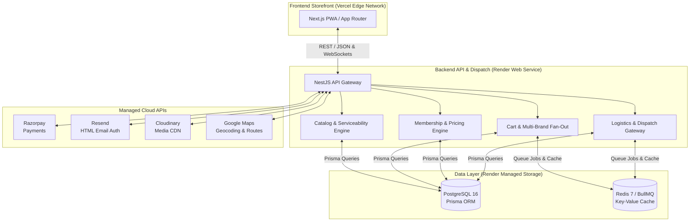

<div align="center">

  <h1>🍽️ CraveOS</h1>
  <p><b>Multi-Brand Cloud-Kitchen Commerce Platform & Delivery Engine</b></p>
  <p><i>One Cart. Multiple In-House Brands. Single Payment & Unified 25-Min Delivery.</i></p>

  <div>
    <a href="https://github.com/FadnisW/CraveOS/actions/workflows/ci.yml">
      
    </a>
    
    
    
    
    
  </div>

  <br />

  <a href="#-architecture">Architecture</a> •
  <a href="#-key-features">Key Features</a> •
  <a href="#-tech-stack">Tech Stack</a> •
  <a href="#-getting-started">Getting Started</a> •
  <a href="#-monorepo-structure">Structure</a> •
  <a href="#-deployment">Deployment</a>

</div>

---

## ⚡ Executive Overview

**CraveOS** is a production-grade multi-brand cloud-kitchen commerce platform engineered to operate virtual restaurant portfolios (such as BOX8, MOJO Pizza, LeanCrust, ZAZA Mughal Biryani, Mealful Rolls, WeFit Bowls, NH1 Bowls, and Itminaan Matka Biryani) physically co-located in shared **Cloud-Kitchen Hubs**.

Unlike traditional food delivery aggregators (e.g., Zomato, Swiggy) that aggregate third-party restaurants with separate pickups, CraveOS enables customers to **mix dishes from multiple distinct food brands into a single cart**, with **one checkout**, **zero delivery/packaging/platform fees**, and **a single consolidated delivery trip**.

---

## 🚀 Key Features

| Feature | Description |
| :--- | :--- |
| **🛍️ Multi-Brand Cart** | Mix items from 8+ in-house brands (Pizza, Biryani, Bowls, Rolls) into a single cart. |
| **⚡ Atomic Order Fan-Out** | Server-side split of 1 customer `Order` into N `BrandOrder` entries routed to respective Kitchen Display Systems (KDS) instantly. |
| **💎 EatClub-Style Membership** | Always-on flat percentage discounts & ₹0 packaging, platform, and delivery fees for subscribed members. |
| **⏱️ Hyperlocal Serviceability** | Sub-200ms spatial geofence matching (`Hub.servicePolygon`) & drive-time ETA calculations via Google Maps Routes API. |
| **🏷️ Time-Bound Offer Engine** | Dynamic rules for **Happy Hours** (4–6 PM @ ₹99) and **Meal of the Day** rails computed server-side per time window. |
| **👛 Append-Only Wallet Ledger** | Immutable audit trail for cashbacks, promotional grants, and referral earnings auto-applied at checkout. |
| **📡 Real-Time Order Timeline** | Sub-second WebSocket order state tracking and live rider GPS updates on an interactive map. |

---

## 🏗️ Architecture

CraveOS is structured as a **Dual-Deployed Workspace**:
1. **Frontend PWA Storefront** (`apps/web`): Next.js 14 App Router deployed on **Vercel Edge**.
2. **Backend API & Async Worker** (`apps/api`): NestJS Modular Monolith deployed on **Render** (Web Service + BullMQ Worker).



---

## 🛠️ Tech Stack

<table align="center">
  <tr>
    <td align="center" width="160">
      <br />
      <b>Next.js 14</b><br />
      <sub>PWA & Edge Storefront</sub>
    </td>
    <td align="center" width="160">
      <br />
      <b>NestJS 10</b><br />
      <sub>Modular Monolith</sub>
    </td>
    <td align="center" width="160">
      <br />
      <b>Prisma ORM</b><br />
      <sub>Type-Safe DB Layer</sub>
    </td>
    <td align="center" width="160">
      <br />
      <b>PostgreSQL 16</b><br />
      <sub>Master Relational DB</sub>
    </td>
  </tr>
  <tr>
    <td align="center" width="160">
      <br />
      <b>Redis 7 & BullMQ</b><br />
      <sub>Queues & Caching</sub>
    </td>
    <td align="center" width="160">
      <br />
      <b>Tailwind CSS</b><br />
      <sub>Design System</sub>
    </td>
    <td align="center" width="160">
      <br />
      <b>TypeScript</b><br />
      <sub>End-to-End Safety</sub>
    </td>
    <td align="center" width="160">
      <br />
      <b>Docker Compose</b><br />
      <sub>Local Parity</sub>
    </td>
  </tr>
</table>

---

## 📂 Monorepo Structure

```
craveos/
├── .github/
│   └── workflows/          # GitHub Actions CI/CD Pipeline
├── apps/
│   ├── web/                # Next.js 14+ PWA Storefront (Vercel)
│   └── api/                # NestJS API Gateway & BullMQ Worker (Render)
├── packages/
│   └── shared-types/       # Shared TypeScript Interfaces, DTOs & Schemas
├── prisma/
│   ├── schema.prisma       # Master Database Schema
│   └── seed.ts             # Hubs, Brands, Menus & Membership Seeder
├── prototype/              # React Prototype Reference Implementation
├── docker-compose.yml       # Local Dev Infrastructure (Postgres 16 + Redis 7)
└── package.json            # Monorepo Workspace Root Configuration
```

---

## 💻 Getting Started

### Prerequisites
- **Node.js**: `v20.x` or higher
- **npm**: `v10.x` or higher
- **Docker Desktop**: Running locally for PostgreSQL & Redis

### 1. Clone the Repository
```bash
git clone https://github.com/FadnisW/CraveOS.git
cd CraveOS
```

### 2. Install Dependencies
```bash
npm install
```

### 3. Spin Up Local Infrastructure
```bash
docker-compose up -d
```

### 4. Run Prisma Migrations & Seed Database
```bash
npx prisma migrate dev --name init
npx prisma db seed
```

### 5. Launch Development Environment
```bash
npm run dev
```
- **Storefront (Next.js)**: `http://localhost:3000`
- **Backend API (NestJS)**: `http://localhost:4000/api/v1`
- **Prisma Studio**: `npx prisma studio` (`http://localhost:5555`)

---

## 🚢 Deployment Architecture

- **Frontend App**: Deployed automatically to **Vercel** on push to `main` or `staging`.
- **Backend API**: Deployed as a **Render Web Service** with `npx prisma migrate deploy` pre-deploy step.
- **Background Worker**: Deployed as a **Render Background Worker** process executing BullMQ queue jobs for order fan-out and notification delivery.

---

## 📜 License

This project is licensed under the [MIT License](LICENSE).

---

<div align="center">
  <sub>Built with ❤️ for multi-brand cloud-kitchen scale. Engineered by <b>FadnisW</b>.</sub>
</div>
