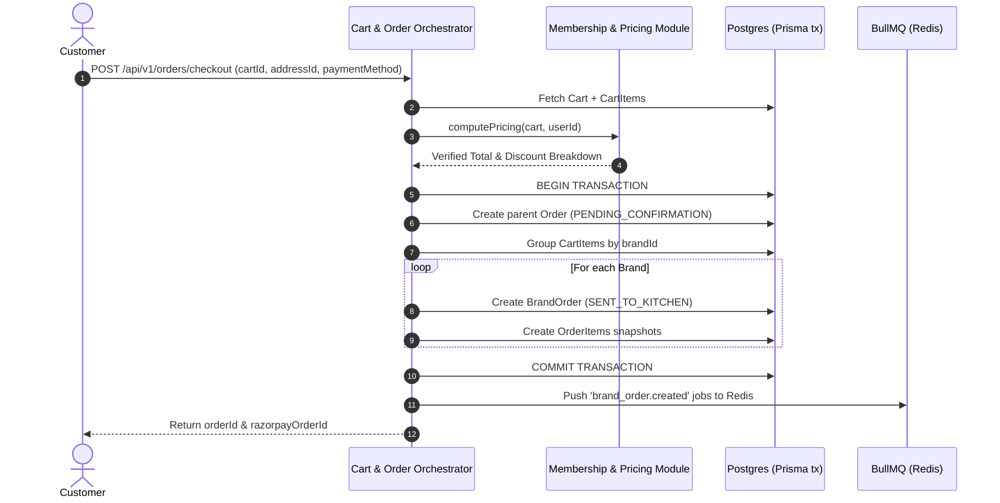

# CraveOS — Technical Implementation Plan

**Target Architecture:** Modular Monolith (NestJS API & Worker on Render) + Next.js PWA Storefront (Vercel)  
**Database Topology:** Single PostgreSQL DB (Prisma ORM) + Redis (Render Key Value / BullMQ)  
**External Services:** Razorpay (Payments), Resend (HTML Transactional Email Auth & Notices), Cloudinary (Media CDN), Google Maps Platform (Places Autocomplete, Geocoding, Routes API)

---

## 🎯 Executive Overview & Implementation Strategy

This implementation plan details the step-by-step transition of CraveOS from its existing React prototype into a fully production-ready, dual-deployed application architecture.

```
craveos/
├── apps/
│   ├── web/                # Next.js 14+ PWA Frontend (Vercel Edge)
│   └── api/                # NestJS Modular Monolith API & WebSocket (Render Web Service)
├── packages/
│   └── shared-types/        # Shared DTOs, Zod Schemas & Prisma Type Exports
├── prisma/                  # Master Database Schema & Migrations
└── docker-compose.yml       # Local Dev Environment (NestJS + Postgres 16 + Redis 7)
```

---

## 📑 Phase 1: Project Restructuring, NestJS Backend Setup & Schemas

### Goal
Establish the monorepo workspace, scaffold the NestJS API & Worker services, configure Docker Compose for local development, define the complete Prisma PostgreSQL schema, and seed realistic multi-brand hub data.

---

### Step 1.1: Monorepo & Directory Structure Setup
- Setup Turborepo / NPM Workspaces in repository root.
- Move existing React frontend into `apps/web/`.
- Initialize `apps/api/` as a NestJS project (`@nestjs/cli`).
- Initialize `packages/shared-types/` with TypeScript configuration and build scripts.
- **Verification:** Run `npm run build` from root to verify workspace resolution.

---

### Step 1.2: Local Development Parity (`docker-compose.yml`)
Create `docker-compose.yml` in repository root:
- `postgres:16` container with persistent volume and port mapping `5432:5432`.
- `redis:7` container with port mapping `6379:6379`.
- `api` container linked to Postgres and Redis for local integration testing.
- **Verification:** Run `docker-compose up -d` and verify Postgres (`pg_isready`) and Redis (`redis-cli ping`).

---

### Step 1.3: Prisma Schema Definition (`prisma/schema.prisma`)
Define all domain entities in `prisma/schema.prisma`:
- **User & Auth:** `User`, `Address`
- **Catalog & Hubs:** `Brand`, `Hub` (with `servicePolygon` JSON), `BrandKitchen`, `MenuItem`
- **Cart & Ordering:** `Cart`, `CartItem`, `Order`, `BrandOrder`, `OrderItem`
- **Payment & Wallet:** `Payment`, `WalletTransaction` (append-only ledger)
- **Membership & Pricing:** `Membership`, `MembershipPlan`, `PricingRule`
- **Logistics:** `DeliveryTrip`
- **Auditing:** `AuditLog`
- **Indexes:** Composite index on `MenuItem[brandKitchenId, isAvailable]`, index on `Order[userId, createdAt]`, index on `BrandOrder[orderId, status]`, index on `WalletTransaction[userId, createdAt]`.
- **Verification:** Run `npx prisma migrate dev --name init` and confirm clean migration execution.

---

### Step 1.4: Multi-Brand Kitchen Data Seed Script (`prisma/seed.ts`)
Write seed script populating:
- **Cities & Hubs:** 2 metro hubs (e.g. Indiranagar Hub, Koramangala Hub) with GeoJSON polygons.
- **Brands:** BOX8, MOJO Pizza, LeanCrust, ZAZA Mughal Biryani, Mealful Rolls, WeFit Bowls, NH1 Bowls, Itminaan Matka Biryani.
- **BrandKitchens & MenuItems:** 10+ items per brand per hub with MRP and member prices.
- **Membership Plans:** Free Trial (14 days), Quarterly (₹299/3 mo, 30% off), Annual (₹499/yr, 30% off).
- **Pricing Rules:** Happy Hour rule (4-6 PM, 40% off select appetizers), Meal of the Day rule (@₹99).
- **Verification:** Run `npx prisma db seed` and inspect seeded records in Prisma Studio (`npx prisma studio`).

---

## ⚙️ Phase 2: Core Backend Modules, Pricing Engine & Multi-Brand Order Fan-Out

### Goal
Implement NestJS feature modules for Identity, Catalog & Serviceability, Pricing Rules, Cart & Order Orchestration, and Payments with strict transaction boundaries.



---

### Step 2.1: Identity & Auth Module (`apps/api/src/modules/auth`)
- **Email OTP Flow:** Generate 6-digit OTP stored in Redis with 10-min TTL. Send HTML email via Resend API.
- **JWT Session Tokens:** Issue HTTP-only JWT upon OTP verification.
- **RBAC Guard (`RolesGuard`):** Scope endpoints by role (`CUSTOMER`, `HUB_STAFF`, `BRAND_OPS`, `ADMIN`).
- **Verification:** Write unit tests for OTP generation/verification and guard enforcement.

---

### Step 2.2: Catalog & Serviceability Engine (`apps/api/src/modules/catalog`)
- **Point-in-Polygon Resolution:** Given lat/lng, query hub polygons stored in Postgres / cached in Redis (`GEOSEARCH`).
- **Google Maps Integration:**
  - `GoogleMapsService`: Resolve place_id via Places API / Geocoding API.
  - Compute ETA to hub using Google Maps Routes API.
- **Hub Roster Endpoint:** `GET /api/v1/serviceability/resolve?lat=X&lng=Y` returning serviceable hub and active brand roster.
- **Stock Management ("86ing"):** `PATCH /api/v1/hubs/:hubId/menu-items/:id/availability` with hub-staff auth verification.
- **Verification:** Test point-in-polygon resolution with test coordinates inside and outside hub boundaries.

---

### Step 2.3: Membership & Pricing Rule Engine (`apps/api/src/modules/pricing`)
- **Deterministic Discount Stacking:**
  1. Membership flat discount (e.g. 30% off item MRP) + zero delivery/packaging/platform fees.
  2. Dynamic Pricing Rule (Happy Hour / Meal of the Day).
  3. Active Coupon code discount.
  4. Wallet balance redemption (capped at max allowed order percentage).
- **Server-Side Re-Pricing:** `PricingService.computePricing(tx, { cart, userId })` re-evaluates all prices server-side.
- **Verification:** Unit test pricing calculation across edge cases (expired membership, stacked coupon + happy hour, wallet cap).

---

### Step 2.4: Cart & Multi-Brand Order Fan-Out (`apps/api/src/modules/orders`)
- **Cart Pinned to Hub:** Enforce that all items added to a cart belong to brands servable by the cart's `hubId`.
- **Atomic Fan-Out (`OrdersService.createOrder`):**
  - Execute within `prisma.$transaction`.
  - Validate current item availability (`isAvailable === true`).
  - Create parent `Order` record (`totalInPaise`, `discountBreakdown` JSON).
  - Group cart items by `brandId` and create `BrandOrder` records + `OrderItem` snapshots.
  - Enqueue `brand_order.created` jobs to BullMQ for KDS routing.
- **Verification:** Integration test verifying 1 cart with items from 3 brands creates 1 parent `Order` and 3 `BrandOrder` records atomically.

---

### Step 2.5: Payment & Wallet Module (`apps/api/src/modules/payments`)
- **Razorpay Order Creation:** `POST /api/v1/payments/create-razorpay-order`.
- **HMAC Signature Verification Webhook:** `POST /api/v1/webhooks/razorpay` with raw-body parsing (`rawBody: true`).
- **Idempotency Guard:** Check `Payment.status === 'SUCCESS'` before applying updates to prevent duplicate execution.
- **Append-Only Wallet Ledger:** `WalletTransaction` writes with `SELECT ... FOR UPDATE` row locks to prevent double-spend concurrency issues.
- **Partial Refund Automation:** Method `issuePartialRefund(brandOrderId)` to refund rejected brand items to customer wallet instantly.
- **Verification:** Integration test simulating Razorpay webhook signature verification and concurrent wallet transactions.

---

## 📡 Phase 3: Real-Time WebSockets, Queue Workers & Logistics Dispatch Console

### Goal
Implement background worker processing with BullMQ, WebSocket real-time event distribution for Kitchen Display Systems (KDS) and live order tracking, rider logistics dispatch, and Resend transactional email notifications.

```
                           ┌────────────────────────┐
                           │   NestJS API Gateway   │
                           │   (Render Web Service) │
                           └───────────┬────────────┘
                                       │ WebSocket
                                       ▼
                       ┌────────────────────────────────┐
                       │  OrderTrackingGateway (WS)     │
                       │  - Room: order:{orderId}       │
                       │  - Room: hub:{hubId}:kds       │
                       └───────────────▲────────────────┘
                                       │ Redis Pub/Sub
                                       │
                       ┌───────────────┴────────────────┐
                       │   BullMQ Worker Service        │
                       │   (Render Worker Process)      │
                       │   - brand-orders queue         │
                       │   - notifications queue        │
                       │   - logistics queue            │
                       └────────────────────────────────┘
```

---

### Step 3.1: BullMQ Queue Infrastructure Setup (`apps/api/src/modules/queue`)
- Configure BullMQ queues in NestJS:
  - `brand-orders`: KDS dispatch & SLA monitoring.
  - `notifications`: Async email dispatch via Resend.
  - `logistics`: Rider auto-assignment & stale trip detection.
- Scaffold Render Worker process entrypoint (`apps/api/src/worker.ts`).
- **Verification:** Push test job to BullMQ queue and assert worker execution in logs.

---

### Step 3.2: NestJS WebSocket Gateway (`apps/api/src/modules/websockets`)
- Create `OrderTrackingGateway` using `@nestjs/websockets` (Socket.IO).
- Rooms:
  - `order:{orderId}`: Subscribed by Customer client for live tracking pings.
  - `hub:{hubId}:kds`: Subscribed by Kitchen Display System for new `BrandOrder` alerts.
  - `hub:{hubId}:dispatch`: Subscribed by Admin Dispatch Console for rider GPS & trip queues.
- Throttled emission of rider GPS updates (every 3-5 seconds).
- **Verification:** Connect Socket.IO client, join `order:123`, emit event, assert payload reception.

---

### Step 3.3: Logistics & Rider Dispatch Engine (`apps/api/src/modules/logistics`)
- **Rider Assignment Algorithm:**
  - Auto-assign nearest available rider in hub pool upon all `BrandOrder`s reaching `ACCEPTED` status.
- **Live GPS Ingestion:** `POST /api/v1/logistics/trips/:id/location` updating `DeliveryTrip.liveLat/liveLng` and publishing to WebSocket room.
- **Stale Trip Monitor:** Scheduled BullMQ job checking for trips without GPS pings > 2 minutes; flag status as `STALE` for admin intervention.
- **Verification:** Test rider assignment trigger and stale trip cron detection.

---

### Step 3.4: HTML Email Notification Module (`apps/api/src/modules/notifications`)
- Design responsive HTML templates:
  - Email OTP Login Template
  - Order Confirmation Invoice Template
  - Partial Brand Refund Notice Template
  - Membership Renewal Reminder Template
- Send emails asynchronously via Resend API inside BullMQ processor.
- **Verification:** Trigger email job in test mode and verify HTML rendering & Resend API response.

---

## 🎨 Phase 4: Frontend API Integration & UI System Wiring

### Goal
Migrate `src/` to Next.js App Router structure in `apps/web/`, replace mock data with type-safe API client calls, wire Zustand client state stores, integrate Google Maps widgets, and connect WebSocket tracking pings.

---

### Step 4.1: Next.js PWA Scaffold (`apps/web/`)
- Setup App Router directory structure:
  - `app/(storefront)/page.tsx` (Home Feed, Brand Grid, Deal Rails)
  - `app/(storefront)/brand/[slug]/page.tsx` (Brand Menu View)
  - `app/cart/page.tsx` (Multi-Brand Cart Drawer & Summary)
  - `app/checkout/page.tsx` (Checkout & Razorpay Payment)
  - `app/orders/[id]/track/page.tsx` (Live Order Tracking Map)
  - `app/membership/page.tsx` (Membership Plans & Upgrade)
  - `app/account/page.tsx` (Wallet, Referrals, Saved Addresses)
  - `app/admin/kds/page.tsx` (Kitchen Display System)
  - `app/admin/dispatch/page.tsx` (Logistics Dispatch Console)
- Configure PWA manifest (`manifest.json`) and service worker for offline shell caching.
- **Verification:** Run `next build` and verify clean static generation & edge route compilation.

---

### Step 4.2: Type-Safe API Client (`apps/web/lib/api-client.ts`)
- Implement fetch wrapper around NestJS API endpoints with automatically attached JWT bearer tokens.
- Export Zod-validated response types shared from `packages/shared-types`.
- Add global request interceptor handling 401 Unauthorized (trigger OTP modal) and network errors.
- **Verification:** Test API client methods against local NestJS API running in Docker.

---

### Step 4.3: Client State Synchronization (Zustand Stores)
- `useCartStore`: Persistent multi-brand cart state synced with `POST /api/v1/cart/sync`.
- `useServiceabilityStore`: Store resolved delivery address, place_id, lat/lng, resolved `hubId`, and active brand roster.
- `useAuthStore`: Manage current user session, wallet balance, and membership status.
- **Verification:** Test adding items from Brand A and Brand B to cart; verify grouping by brand and correct subtotal calculations.

---

### Step 4.4: Google Maps & Live Tracking Integration
- Embed Google Maps Places Autocomplete widget in location picker modal.
- Build live order tracking map view using `@react-google-maps/api` with animated rider marker interpolation between WebSocket GPS pings.
- Fallback polling every 10 seconds if WebSocket disconnects.
- **Verification:** Simulate rider location updates via backend API and verify smooth marker movement on customer tracking map.

---

### Step 4.5: Razorpay Checkout Integration (`app/checkout/page.tsx`)
- Load Razorpay JS SDK script on checkout screen.
- Handle checkout submission:
  1. Call `/api/v1/orders/checkout` to create parent Order & Razorpay Order ID.
  2. Open Razorpay modal with `razorpayOrderId`, `amount`, and user contact details.
  3. On payment success callback, redirect user to `/orders/[id]/track`.
- Surface wallet balance redemption toggle and real-time membership savings calculation.
- **Verification:** Test end-to-end checkout flow using Razorpay Test Mode card and UPI credentials.

---

### Step 4.6: Kitchen KDS & Dispatch Console UI
- Wire `app/admin/kds/page.tsx` to `hub:{hubId}:kds` WebSocket channel.
  - Audio alert on new `BrandOrder`.
  - Action buttons: "Accept Order", "Mark Preparing", "Mark Ready".
  - Out-of-stock toggle ("86 item") sending PATCH mutation to backend.
- Wire `app/admin/dispatch/page.tsx` to `hub:{hubId}:dispatch` WebSocket channel.
  - Live rider pool status map.
  - Queue of unassigned trips.
  - Manual rider reassignment drag-and-drop tool.
- **Verification:** Perform complete order cycle: Place multi-brand order -> Accept on KDS -> Assign rider on Dispatch -> Track to delivery on customer view.

---

## 🧪 Comprehensive Verification & Test Strategy

| Test Layer | Tools | Target Coverage | Key Scenarios Tested |
| :--- | :--- | :--- | :--- |
| **Unit Tests** | Vitest / Jest | Pure pricing functions, discount rules | Membership flat discount, happy hour window evaluation, coupon precedence, wallet caps. |
| **Integration Tests** | Supertest + Postgres container | API endpoints & DB transactions | Multi-brand fan-out into `BrandOrder`s, Razorpay HMAC webhook verification, wallet double-spend locks. |
| **E2E Tests** | Playwright | Full browser customer journeys | Address selection -> Brand menu browse -> Multi-brand cart -> Razorpay test payment -> Live map tracking. |
| **Load Tests** | k6 / Artillery | Peak checkout throughput | 500 concurrent checkouts/sec under 2-second p95 latency. |

---

## 🚀 Risk Matrix & Mitigation Strategies

| Risk | Impact | Likelihood | Mitigation Strategy |
| :--- | :---: | :---: | :--- |
| **Partial Brand Kitchen Rejection** | High | Medium | Automated partial refund to wallet for rejected brand items; remaining brand orders proceed normally. |
| **Razorpay Webhook Delivery Delay** | High | Low | Idempotent webhook handler + client polling fallback (`GET /orders/:id/status`) for order confirmation reconciliation. |
| **High WebSocket Connection Concurrency** | Medium | Medium | Redis Pub/Sub adapter for Socket.IO scaling across API instances; throttled GPS emission (3-5s). |
| **Cart Cross-Hub Conflict** | Medium | Low | Strict client & server validation pinning cart to resolved `hubId`; inline warning prompt to switch address or clear cart. |

---
*End of Implementation Plan.*
