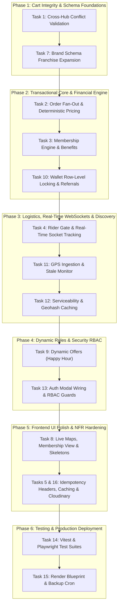

# CraveOS — Task-by-Task Master Implementation Plan

This plan establishes the execution sequence for fulfilling all architectural and UI/UX requirements from the CraveOS Software Design Document. The tasks are arranged in strict order of dependency so each step builds upon solid, validated foundations without regressions.

---

## 🎯 Recommended Starting Task: **Task 1 (Cross-Hub Cart Conflict Validation)**

**Why Task 1 first?**
The single-pickup-point guarantee is the foundational pillar of CraveOS. If users can add items from different hubs into a single cart, or switch addresses to an unserviceable hub without warning, all downstream pricing, fan-out, and single-trip rider dispatch mechanisms break. Resolving Task 1 locks down cart integrity before we refine order execution.

---

## 🗺️ Master Execution Roadmap

---

## Phase 1: Cart Integrity & Schema Foundations

### 1. Task 1: Cross-Hub Cart Conflict Validation [COMPLETED ✅]
- **Objective:** Enforce that all items in a cart belong to the same resolved hub.
- **Frontend Changes:**
  - `src/context/CartContext.tsx`: Guard `addToCart()` against `pinnedHubId`. If an item is from a different hub, block addition and trigger `pendingConflict`. Added `resolveConflict(clearAndSwitch)` method.
  - `src/components/HubConflictModal.tsx`: Interactive prompt with "Keep Current Cart" vs. "Clear Cart & Switch Hub", comparing current hub and incoming item hub.
  - `src/components/SavedAddressModal.tsx`: When changing address to an address resolved to a different hub, triggers an inline conflict view prompting the user to keep current cart or clear & switch.
  - `src/App.tsx`: Mounted `HubConflictModal` globally.
- **Backend Verification:**
  - `apps/api/src/modules/orders/orders.service.ts`: Added validation verifying `dbItem.brandKitchen.hubId === dto.hubId` inside `createOrder()`, returning 400 Bad Request on cross-hub conflict.

### 2. Task 7: Multi-Brand Franchise Expansion Flags
- **Objective:** Future-proof the `Brand` model for third-party cloud kitchens.
- **Changes:**
  - `prisma/schema.prisma`: Add `isOwned Boolean @default(true)` and `commissionPct Float?` to `model Brand`.
  - Update `src/types.ts` `Brand` interface with matching optional fields.

---

## Phase 2: Transactional Core & Financial Engine

### 3. Task 2: Consolidated Order Fan-Out & Deterministic Pricing
- **Objective:** Connect the backend `PricingService` directly into `OrdersService.createOrder()` for server-authoritative totals.
- **Changes:**
  - `apps/api/src/modules/orders/orders.service.ts`: Inject `PricingService` and call `calculateCartPrice()` inside the `prisma.$transaction`.
  - Implement **Edge Case 2A**: If any `MenuItem.isAvailable` is false during checkout, rollback with HTTP 409 Conflict.
  - Frontend `src/views/CheckoutScreen.tsx`: Catch 409 and render inline "Item out of stock — remove to continue".

### 4. Task 3: Free Trial Membership Lifecycle & Benefits Engine
- **Objective:** Database-backed membership status and non-member upsell banners.
- **Changes:**
  - `apps/api/src/modules/pricing/pricing.service.ts`: Verify `tx.membership.status === 'ACTIVE' || 'TRIAL'` against `trialEndsAt / renewsAt`.
  - Implement **Edge Case 3A**: Service degradation fallback — if membership DB query fails, fallback to MRP and log for compensating wallet credit.
  - Create BullMQ daily cron to transition expired trials to `EXPIRED` status.
  - `src/components/CartSidebar.tsx` & `src/views/CheckoutScreen.tsx`: Add non-member upsell banner calculating prospective savings.

### 5. Task 10: Referral & Wallet System Engine
- **Objective:** Prevent wallet double-spending under concurrent checkouts and attribute referral bonuses.
- **Changes:**
  - `apps/api/src/modules/orders/orders.service.ts`: Use raw SQL row-level lock (`SELECT wallet_balance FROM users WHERE id = $1 FOR UPDATE`) when debiting wallet balance.
  - Trigger referral bonus credit when a referred user's order transitions to `CONFIRMED` for the first time.
  - `src/views/ProfileScreen.tsx`: Integrate `navigator.share()` Web Share API for referral codes.

---

## Phase 3: Logistics, Real-Time WebSockets & Discovery

### 6. Task 4: Rider Assignment Gate & Real-Time Tracking
- **Objective:** Gate rider assignment until all kitchen tickets are accepted, recalculate invoices on partial rejection, and wire frontend WebSockets.
- **Changes:**
  - `apps/api/src/modules/orders/orders.service.ts`: In `updateBrandOrderStatus`, recalculate and update parent `Order.finalPaidPaise` upon brand rejection (Edge Case 4A).
  - `apps/api/src/modules/logistics/logistics.service.ts`: Check that all `BrandOrder`s are `ACCEPTED` before assigning a rider.
  - `src/views/OrdersScreen.tsx`: Replace `setInterval` polling with `socket.io-client` connection to `OrderTrackingGateway`, with a 10s polling fallback.

### 7. Task 11: Live Tracking & Delivery Dispatch Engine
- **Objective:** GPS ping ingestion, trip staleness monitoring, and smooth marker animation.
- **Changes:**
  - `apps/api/src/modules/logistics/logistics.controller.ts`: Create `POST /logistics/rider/:id/location` to upsert `DeliveryTrip.liveLat/liveLng`.
  - Create BullMQ cron running every 1 minute to flag trips without pings for >2 minutes as `STALE`.
  - `src/views/OrdersScreen.tsx`: Client-side interpolation between GPS coordinates over 3–5 seconds.

### 8. Task 12: Serviceability & Hub Discovery Engine
- **Objective:** Strict boundary resolution and unserviceable fallback UI.
- **Changes:**
  - `apps/api/src/modules/catalog/catalog.service.ts`: Implement Redis Geohash caching (`hub:geohash:{hash}`).
  - `src/views/HomeScreen.tsx`: Render dedicated `<UnserviceableView />` with waitlist capture when an address has no servicing hub.

---

## Phase 4: Dynamic Rules & Security RBAC

### 9. Task 9: Time-Bound Dynamic Offers (Happy Hour)
- **Objective:** Server-driven deal windows and checkout spill-over handling.
- **Changes:**
  - `apps/api/src/modules/pricing/pricing.service.ts`: Evaluate `PricingRule` time windows and expose `/pricing/offers/active`.
  - Frontend `src/views/HomeScreen.tsx`: Consume API instead of hardcoded `Date().getHours()`, and render countdown chips.
  - Implement **Edge Case 9A**: If Happy Hour ends while user is on checkout, re-price to standard price and display an inline banner.

### 10. Task 13: Security, RBAC & Auditing Engine
- **Objective:** Real OTP authentication and staff role enforcement.
- **Changes:**
  - `src/components/AuthModal.tsx`: Wire input fields to `api.requestOtp` and `api.verifyOtp`.
  - `apps/api/src/common/guards/roles.guard.ts`: Implement NestJS `@Roles()` decorator restricting Hub Staff mutations to their assigned `session.hubId`.

---

## Phase 5: Frontend UI Polish & NFR Hardening

### 11. Task 8: Frontend UI/UX Specification Polish
- **Objective:** Google Maps integration, dedicated Membership view, and design token compliance.
- **Changes:**
  - `src/views/OrdersScreen.tsx`: Embed `@react-google-maps/api` full-bleed map behind status timeline sheet.
  - Create `src/views/MembershipScreen.tsx`: Plan comparison card and historical savings calculator.
  - Replace `animate-spin` generic loaders with `<MenuItemSkeleton />` components.
  - `src/index.css`: Add global `.tabular-nums { font-variant-numeric: tabular-nums; }`.

### 12. Tasks 5 & 16: NFRs, Caching & Performance
- **Objective:** Idempotency key headers, Redis cache busting, and Cloudinary image loader.
- **Changes:**
  - `src/lib/api-client.ts`: Send `Idempotency-Key` header (`SHA256(cartId + userId + Math.floor(Date.now() / 300000))`).
  - `apps/api/src/modules/catalog/catalog.service.ts`: Trigger `DEL cache:menuItems:{hubId}` in Redis when an item is 86'd.
  - Storefront image components: Implement Cloudinary WebP optimization and lazy loading.

---

## Phase 6: Testing & Production Deployment

### 13. Task 14: Testing Strategy & Implementation
- **Objective:** Comprehensive unit and integration test coverage.
- **Changes:**
  - Configure Vitest in `apps/api` and write `pricing.service.spec.ts` (discount priority stack verification).
  - Configure Playwright and write E2E tests for Multi-brand fan-out, partial brand rejection, and wallet double-spend concurrency.

### 14. Task 15: CI/CD & Production Deployment
- **Objective:** Render infrastructure blueprint and automated backups.
- **Changes:**
  - Create `render.yaml` declaring Web Service, Background Worker, PostgreSQL, and Redis.
  - Set `preDeployCommand: npx prisma migrate deploy`.

---

## Verification Plan

### Automated Tests
- Unit Tests: `npm run test` inside `apps/api` to verify discount priority order and pricing calculations.
- E2E Tests: `npx playwright test` to verify multi-brand checkout and partial rejection wallet credits.

### Manual Verification
1. **Hub Conflict Test:** Open storefront, add items from BOX8 (HSR Hub), attempt to add item from an Indiranagar Hub brand -> Verify `HubConflictModal` appears.
2. **Multi-Brand Fan-Out & KDS Test:** Build cart with items from 2 brands -> Checkout -> Open `/admin-kds` -> Verify 2 distinct tickets appear under their respective kitchen queues.
3. **Partial Rejection Test:** Reject 1 brand ticket in KDS -> Check user profile -> Verify exact amount is credited to wallet balance.
4. **WebSocket Test:** Open customer order tracking tab and KDS tab side-by-side -> Transition ticket to "Preparing" -> Confirm customer screen updates sub-second without page refresh.
